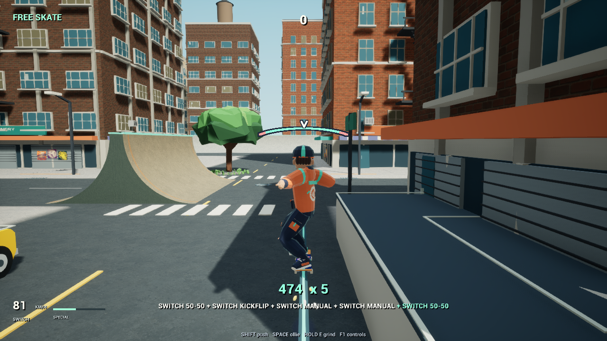

# Grave / Grind

**An arcade skating × survival-action prototype in Unreal Engine 5.8.**

I’m combining the momentum and trick chaining of Tony Hawk’s Pro Skater with the enemy pressure and run progression of Megabonk. The goal is a city where skating provides both satisfying movement and routes through survival encounters.

*Controller-replay capture from the development build, 27 October 2026.*

## Development library

This portfolio records significant decisions, resolved problems and completed features. Implementation and Unreal assets remain in a private workshop; the public library contains focused case studies and selected evidence.

- [Current delivery — 30 October 2026](devlog/2026-10-30-01-desktop-delivery.md) — First Ride, session protection, desktop settings, district crowds and the four-district reward correction.
- [Kitchen and tour](devlog/2026-10-29-02-kitchen-and-tour.md) — giant kitchen, route choices and the earlier full-tour obstruction.
- [Connected campaign](devlog/2026-10-29-01-connected-campaign.md) — skating attacks, showdowns, the finale, reward accounting and larger crowds.
- [Skating-survival milestone — 28 October 2026](devlog/2026-10-28-01-skating-survival-loop.md) — connected rewards, weapon builds, encounters and honest run evidence.
- [Earned progression and save recovery](devlog/2026-10-28-02-earned-progression.md) — starting playstyles, desktop controls and recovery across a failed write and fresh launch.
- [Districts and combat clarity](devlog/2026-10-28-03-districts-and-combat-clarity.md) — Hollow, Neon, the Bell Warden, readable threats and rider visibility.
- [Latest skating improvement](devlog/2026-10-27-04-flip-catch.md) — synchronized foot catches and distinct flip motions.
- [Skating acceptance and lessons](devlog/2026-10-27-05-skating-acceptance.md) — five connected routes, a misleading replay and a more focused verification process.
- [Development library](devlog/README.md) — dated decisions and problem-solving entries.
- [Changelog](CHANGELOG.md) — short chronological index.
- [Product brief](docs/product.md) — player experience and scope.
- [System map](docs/system-map.md) — connections between movement, presentation and survival.
- [Documentation process](docs/progress-workflow.md) — editorial and publishing workflow.

## Current checkpoint

| Area | Recorded evidence |
| --- | --- |
| Skating | A connected ollie, grind, kickflip, two manual landings and second grind preserve a five-trick combo. |
| Inputs | Keyboard/regular and controller/switch automated replays pass the selected street line. |
| Animation | Feet return with the completed flip; kickflips and heelflips use opposite flick directions. |
| Survival loop | Six weapon families, skating-linked attacks and evolutions, recurring encounters, gate showdowns, distinct bosses and a phased finale. The 0.100.1 ordinary automated four-district run reaches extraction; its rejected reward result exposed a separate validator defect. |
| Progression | Completed runs unlock different starting weapons. An actual earned result survived a controlled save failure, garage retry and fresh-process reload without duplicate rewards. |
| Districts | Borough, Hollow, Neon and After Hours share skating and survival systems. The garage supports a four-district tour with choices of unvisited destinations. |
| Combat clarity | Grouped approach cues, damage attribution, the rider silhouette and foreground crowd clearance. A bounded 0.97 staged sample reached 639 enemies; it is not sustained current-version performance acceptance. |
| First session and delivery | Optional four-lesson First Ride, survival guidance, protected exits, focus pause and safe persistent desktop settings. Local Windows 0.101.0 Shipping ZIP prepared. |
| Verification | Actual 0.101.0 passes 820 integration, 38 menu/input, 16 first-ride/display and five settings-reload checks; final rendered screens inspected. The preceding reward fix has direct disk/relaunch coverage. |
| Current phase | Playable alpha. Complete-run reliability, broader build viability, consistent movement/camera quality and finished presentation remain open. |

These checks support specific routes and mechanics, not a completion percentage. The four-district reward validator now shares the campaign limit; its controlled save/relaunch checks remain distinct from the preceding ordinary victory whose rewards were rejected. Exact THPS feel, clean-machine compatibility, current sustained crowded-frame performance and finished-game quality remain unverified.

Significant case studies include problems encountered, lessons supported by evidence and concrete improvements to the next approach.

## Development approach

I maintain this project as [whenitisnight](https://github.com/whenitisnight), using AI-assisted implementation with documented verification. Desktop comes first; mobile adaptation, music and detailed balance work are deferred.

This repository contains documentation and selected media. A public playable build has not been released.
