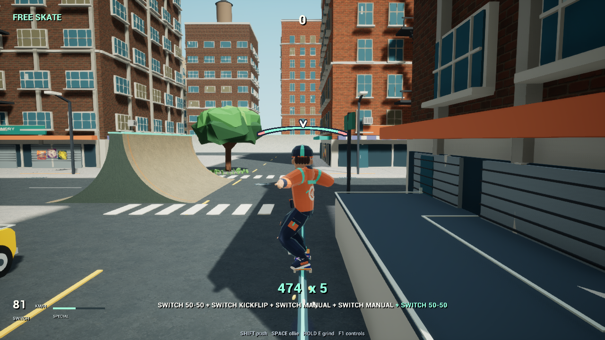

# Grave / Grind

An arcade skating and survival-action prototype in Unreal Engine 5.8.

I am combining momentum, trick chaining and city routes with enemy encounters and evolving weapon builds. Skating should remain useful as a run becomes stronger, rather than serving only as transport between automatic attacks.

*Automated controller-replay capture from October 27, 2026; historical presentation evidence.*

## Current state

Windows development checkpoint **0.127** connects build-powered skating, cooperative ranged targeting, committed encounter formations and a clearer action dock. The four-district prototype includes six weapon families, run progression, bosses and save recovery.

The November 6 delivery record reports **1,797 packaged mechanics checks passing**. These checks support specific behavior. Human enjoyment, sustained crowded performance, physical-input acceptance and clean-machine compatibility remain unverified. No public playable build has been released.

## Project library

| Read | Purpose |
| --- | --- |
| [Latest milestone](devlog/2026-11-19-skating-and-weapon-cooperation.md) | Why skating and weapon systems changed, evidence, failures and limits |
| [Product brief](docs/product.md) | Player experience, implemented scope and remaining work |
| [System map](docs/system-map.md) | How movement, combat, progression and presentation connect |
| [Case studies](devlog/README.md) | Focused development decisions and problem-solving history |
| [Changelog](CHANGELOG.md) | Short chronological index |

Implementation and Unreal assets remain in a separate private workshop. This public repository contains selected documentation and media, with AI-assisted development and the scope of verification stated explicitly.

[William Haggard / whenitisnight](https://github.com/whenitisnight)
