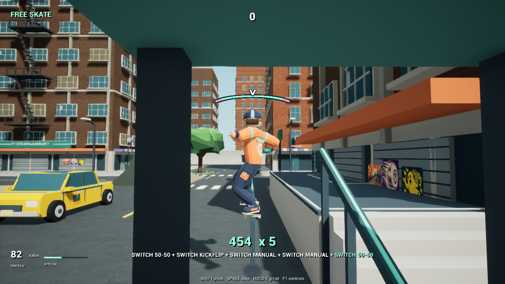

# Connecting a street skating line

**27 October 2026 · Implemented and checked in the development build**

The route starts on the street: charged ollie into a low rail, kickflip out, manual onto a planter, another manual after dropping to the street, and an ollie into the next rail. This connects common actions instead of checking each trick only in isolation.

## What broke the flow

The initial catch pulled the rider too far toward the rail end. Later in the line, a neighboring stair or dock rail could win over the intended rail straight ahead. Broad body collision also produced false landings and sticky motion beside a planter. Beneath a shelter, the camera could suddenly collapse toward the rider while moving around a post.

## What changed

- Forward rail-end acquisition is limited separately from generous side assistance. An aligned, imminently reachable rail can retain preference without attaching early.
- Landing and riding use a consistent wheel-support footprint. Edge separation resolves lateral overlap without repeatedly stopping forward travel.
- Camera selection considers continuity beneath the roof and clearance through an interpolated turn around a post.

Earlier work on body follow-through, manual counterbalance, rail settling and landing compression remains included in this checkpoint.

## Evidence

Keyboard/regular and controller/switch replays complete the 2.3-second street line with an unbroken five-trick combo. The movement suite reports **858 passes and zero failures**.

The first catch-frame travel in the clean approach fell from 230.494 cm to 105.946 cm. In the controller shelter case, minimum camera distance increased from 156.28 cm to 575.33 cm after the clearance fix. These numbers describe the selected route; they are not global quality scores.

*Selected frame from the controller replay, beneath the shelter.*

*The same line reaches the intended second rail with the combo intact.*

## Status and remaining work

The specific route issues were resolved, and the project received a private source-and-asset rollback checkpoint. The evidence comes from automated Unreal input events and rendered-frame review, not hands-on equivalence testing against THPS. Audio was disabled during these replays.

The full skating-survival experience, crowded combat readability and broader visual target still need work. This entry establishes the public journal's starting baseline; it does not reconstruct every earlier session or imply the entire game was built on this date.
