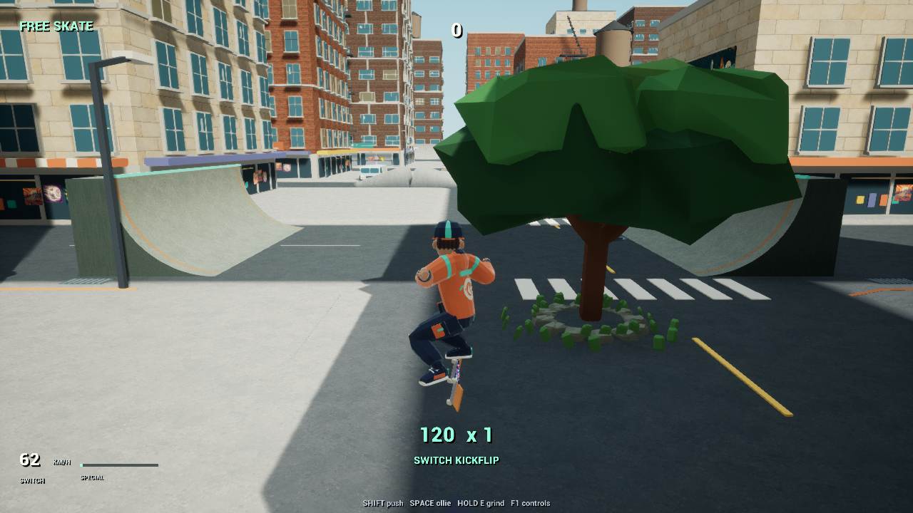
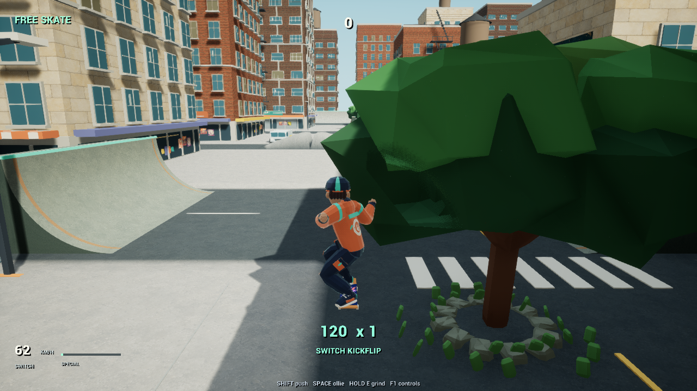

# Bringing the feet back with the board

**27 October 2026 · Skating animation continuity**

## Problem

A flip should finish with a convincing catch before the next landing or manual. The board previously completed its rotation while the feet were still returning from their released pose. A focused measurement found up to 17.65 cm of separation between the ankle positions and their intended deck-contact targets at flip completion.

Kickflips and heelflips also shared the same sideways foot flick, despite rotating the board in opposite directions.

## Decision and mechanism

I tied foot return to the board’s remaining rotation instead of waiting for the flip timer to finish. The feet ease back as the final turn closes, using the displayed board angles so presentation follows the visible deck.

The calculation retains complete turns. During a double flip, passing through the first upright revolution does not trigger an early catch. Unexpected surface contact also preserves clearance while the board finishes its catch rotation. The leading foot now flicks through opposite edges for kickflips and heelflips.

This change addresses rider/board presentation while retaining movement inputs, momentum and trick scoring.

## Evidence

The original implementation failed the new completion-contact check. After the change, the maximum measured error fell from **17.65 cm to under 0.1 cm** across the single flip, reverse flip, shuv-it and double-flip cases at 30, 60 and 120 presentation updates per second. These are isolated animation measurements, not performance benchmarks.

The Unreal editor build succeeded and the expanded movement checks recorded **864 passes and zero failures**. A rendered controller replay completed a 2.483-second kickflip → manual → charged ollie → grab → manual line with its four-trick combo intact. Minimum camera distance was 582.12 cm, and maximum camera rotation between sampled frames was 0.13 degrees on that route.

*Controller replay: the feet remain clear during the flip.*

*A later frame from the same replay shows the completed catch before landing. These are successive frames, not a before/after comparison.*

## Scope and next work

I’m keeping the current phase focused on skating transitions, rider/board animation and camera continuity. Survival integration follows that work.

This resolves a specific animation defect. Verification used automated checks, Unreal input events and rendered-frame inspection with audio disabled. It does not establish identical THPS feel or finish the broader skating phase. The current development build includes the change; the older standalone package remains unchanged.
