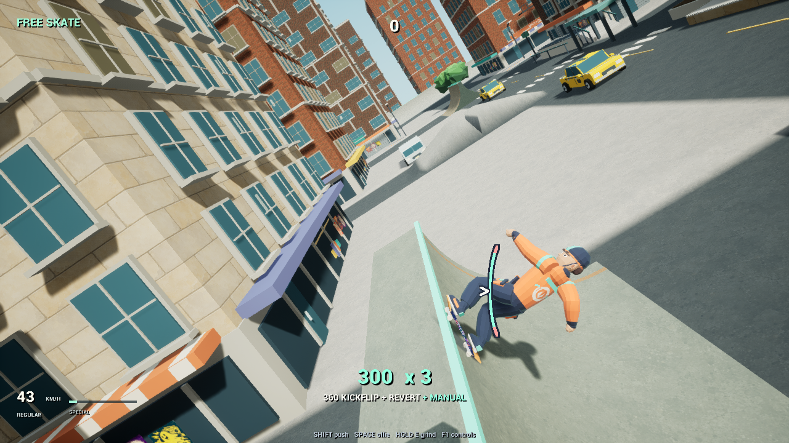
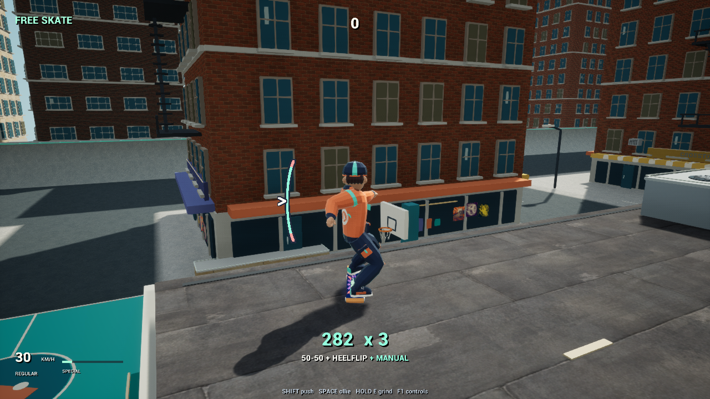

# Checking the skating lines—and the checks themselves

**27 October 2026 · Skating acceptance and development lessons**

## Goal and approach

I wanted to establish whether the recent movement and animation fixes hold together across representative city routes before expanding the survival game. Five short Unreal replays cover street rails, analog steering, repeated ramps, wall interactions and rooftop landings. Each begins with a defined setup and then uses ordinary keyboard or controller input events.

Reference review used the connected tricks around 4:30 and the banked vert camera around 2:27 in [THPS 3+4 gameplay footage](https://www.youtube.com/watch?v=UZRi6Y2-NJk). Those observations support qualitative comparisons of continuity and framing. They do not provide input latency, physics constants or proof of identical feel. The [official THPS 1+2 control guide](https://support.activision.com/tony-hawks-pro-skater-1-2/articles/controls-and-tricks-in-tony-hawks-pro-skater-1-2) supplies common control-family context; different editions are not interchangeable timing specifications.

## Results

| Route | Evidence from this pass |
| --- | --- |
| Controller, switch stance | Ollie → rail → kickflip → two manual landings → second rail; five-trick combo intact over 2.300 simulated seconds. |
| Analog steering and camera | Small-stick carve → camera peek → ollie → kickflip → manual; chase returned within 0.372° of travel heading over 2.217 seconds. |
| Repeated ramps | Three ramp cycles linked flips, spins, reverts and manuals into a nine-trick combo over 7.200 seconds. No terrain blocked the sampled board sightline in 142 return frames. |
| Rooftop | Connected rail corner → heelflip → rooftop manual; three-trick combo intact over 1.200 seconds. |
| Wall | Corrected rail → kickflip → wallride → wallie → manual replay passed with all five tricks present over 1.733 seconds. The initial failure and correction are described below. |

All five selected routes passed. Street and analog routes retained minimum camera distances of 575.33 cm and 582.12 cm respectively. Ramp distance stayed above 485.05 cm. Selected rendered frames were inspected for rider/board contact and visibility. These measurements describe these routes, not every possible camera position.

*Rendered ramp replay with the three-trick chain still active.*

*Rendered rooftop replay. This route starts attached to the edge; it does not test the initial rail catch.*

## Problems encountered and lessons

**A context-sensitive input made the wall replay misleading.** The script pressed Flip while still grinding. That selected a noseslide, which was visible in the trick feed, rather than the aerial flip the assertion expected. The five-trick multiplier alone concealed the mismatch. I changed the replay to request the flip after it observes rail departure, retained the flip assertion and added the active trick and final feed to the evidence. The editor rebuild and corrected replay passed. Gameplay input rules remain unchanged.

**The runner had drifted from its evidence files.** The analog replay produced a report whose name differed from the runner's expectation, and the existing rooftop replay had no runner option. The mapping now points to the actual analog report, and the rooftop route is available through the same runner. A missing report and a failed movement assertion need different diagnoses.

**Correct mechanics can still look wrong.** The preceding [flip-catch investigation](2026-10-27-04-flip-catch.md) found feet lagging behind the completed board rotation despite a broad passing movement suite. The lesson is to measure the visible transition itself and inspect representative frames alongside state checks. A large pass count cannot substitute for convincing animation.

## Better next approach

I’m keeping verification tied to a small, explicit set of player actions. A failure first gets its input context, state transition and rendered result examined. A focused reproduction then determines whether the correction belongs in gameplay, presentation or the replay. The relevant route runs again after the change; unrelated passing routes do not need another loop without a reason.

Future significant entries will include the problems encountered, lessons supported by evidence and a concrete adjustment to the next approach. That record belongs beside the architectural decision, with related cases linked rather than accumulated into one long report.

## Acceptance boundary

This completes the selected technical acceptance pass. No production movement change was justified by these results; the corrections were to verification tooling. The fresh checks complement the earlier **864-pass, zero-failure** movement result; that complete suite was not rerun for this pass. Existing push-contact checks remain earlier evidence, not a fresh hands-on momentum comparison. Automated inputs and frame inspection cannot establish identical THPS feel, controller latency or player preference.

The current development build remains the playable checkpoint. The older standalone package is unchanged. Survival integration, crowded-run performance and finished-game presentation remain later work.
