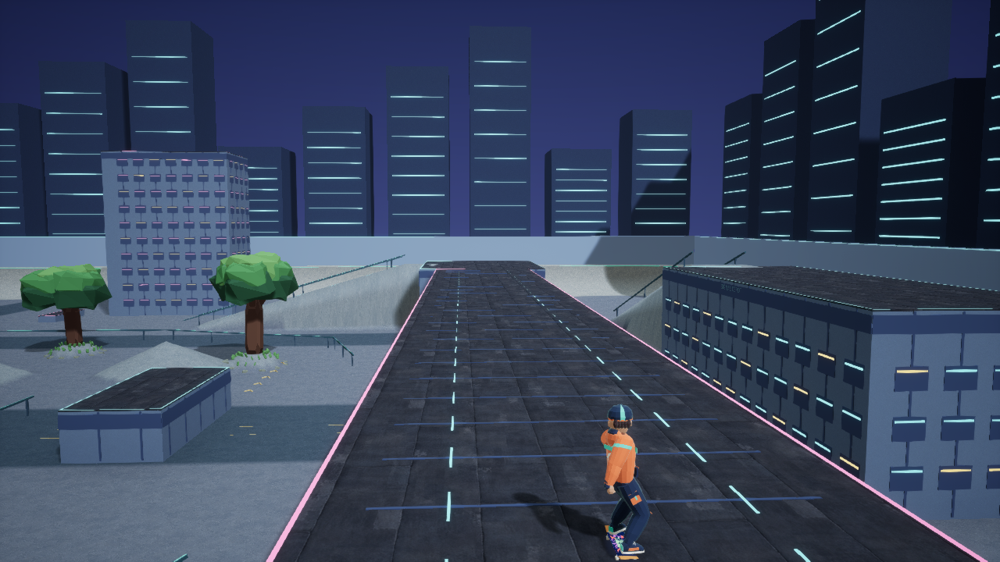
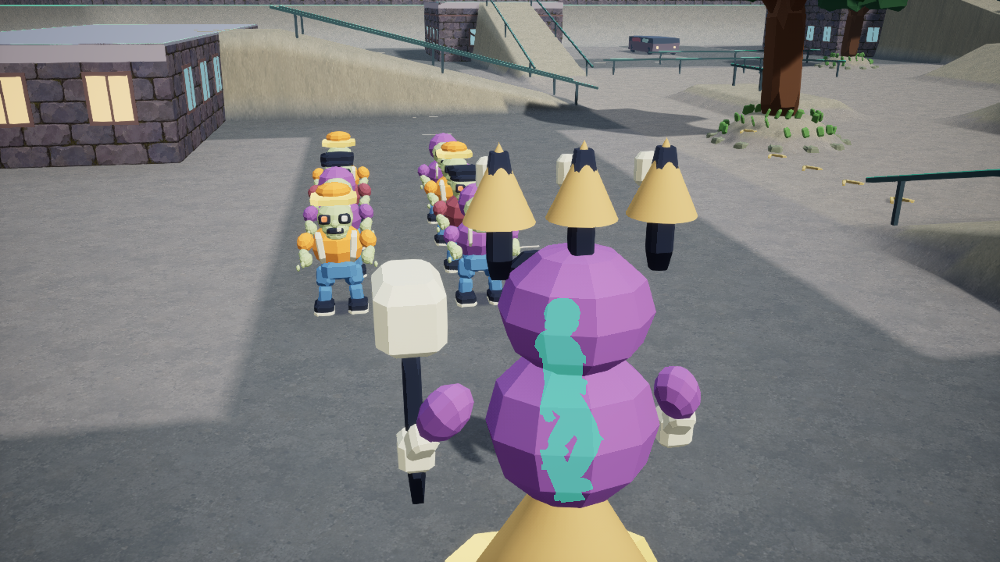

# Distinct districts and readable crowd combat

I wanted district selection to change the routes and encounter decisions, while preserving the skating foundation. The next substantial batch expands the haunted neighborhood, replaces the third practice arena with a transit district, and makes incoming damage easier to understand during crowded skating.

## Routes above and below the street

Hollow expands to 123.4 metres across, with six accessible roofs, approach banks, a connected procession rail, grindable hearses and original generated masonry. Ground attacks now use the supported surface and intervening cover. A wave on a roof can threaten a rider on that roof, while an ollie or a disconnected street changes whether it can reach them.

Neon expands the former 63.4-metre practice bowl to 143.4 metres. Its central spine and hips remain, surrounded by six roof approaches, skatable kiosks, taller street buildings, low props and an elevated transit crossing. Seventy-six interior grind segments connect street and rooftop opportunities. The crossing has a physical underside and an open street beneath it; enemy navigation reaches the upper route through its stations.

Shared block and ramp descriptions drive visible structures, skating support, collision, camera obstruction and enemy navigation. This keeps a promising-looking route from being scenery with no usable landing. Separate panel and sky materials establish Neon's palette without changing the other districts.

*Staged view from the cooked Windows 0.85 standalone. The pose and camera are placed for inspection; this is not an ordinary-run frame.*

## A district encounter and clearer consequences

Hollow's Bell Warden adds three timed waves from a committed position, alongside a marked charge and recovery window. Banking a qualifying trick line during recovery exposes the boss. Its bell, hood and mallet distinguish the encounter at chase-camera distance.

Approaching packs and committed attacks produce a bounded set of grouped directional cues. Actual hits record their direction and mitigated health loss; the defeat screen identifies the last source and the dominant cause of damage. These records explain a loss without silently changing attack timing or damage to produce a better test result.

A large foreground enemy could still hide the rider completely. The animated rider and board now produce a depth-tested silhouette only where another surface occludes them. Exposed geometry keeps its normal shading. Camera tuning and skating rules remain unchanged.

*Staged occlusion comparison from Windows 0.84 with normal world culling enabled.*

## Evidence and its limits

The focused integration pass reaches 362 passing checks. New checks exercise real skating up all six Neon banks, enemy roof access, grind clearance, passage beneath the crossing, head clearance, camera obstruction and valid reward placement. These are targeted simulation checks, not hands-on equivalence to the reference games.

Earlier Hollow evidence includes a 49.05-second scripted victory before the Warden change. The later Warden attempts remain losses: one ended at 34.95 seconds, and another at 51.27 seconds after earning four weapons and an evolution. The latter recorded 83.9 health lost to contact, 58.3 to gravebells, 29.8 to boss waves and 20 to rushes. The policy does not react to the new warnings, so those results establish attribution rather than the cues' benefit to a human player.

Windows 0.85 completed a fresh build, cook and archive. Its overview, underpass and elevated-crossing frames were inspected after the material and roof corrections. A separate ordinary-starter automated run then won in 64.43 seconds with 297 kills, level 19 and 36.9 health remaining. Four earned weapons included evolved Orbital Trucks; the actual boss died and deliberate gate extraction completed. No equipment, health, invulnerability, score or teleport was injected. The 60-second crowd frame and final result were also inspected.

That run demonstrates one useful orbit-focused build and one complete Neon route. It does not establish a three-district victory, settled balance or prolonged horde performance. The verification profile is isolated from real saved progress; the earlier separate persistence checks retain their own version boundary. Complete desktop release acceptance remains open.

## Problems, lessons and the next approach

The first silhouette comparison showed only the board. The procedural body was being culled before contributing to custom depth. An isolated diagnostic confirmed the cause; enlarging only the hero's rendering bounds restored its silhouette with ordinary world culling enabled. The unobstructed view also received a shadow check. Wider bounds still carry rendering implications, so this is not a whole-frame performance claim.

Neon's first navigation attempt turned off the bank as soon as elevation matched the bridge. Extending the target too early then made obstacle avoidance steer around the station. The corrected sequence reaches the crest, continues onto supported roof geometry, and aligns with the crossing before turning. A separate street check initially mistook a later rebound from the depot wall for failure to pass under the bridge; observing the crossing event corrected that interpretation.

Rendered review also exposed assumptions that compilation cannot catch. A reused concrete material had a fixed palette instead of the expected tint parameter, and coincident roof and structure tops produced competing surfaces. A dedicated tinted material and non-overlapping roof thickness address those defects.

Packaging encountered the asset cache's free-space reserve. Lossless compression preserved historical debug files while restoring working space, with content hashes checked before and after. An older rollback executable separately failed its recorded hash; its cause remains unresolved. The file was retained, the version reconstructed from its exact saved source, and the reconstructed standalone checked. I now bind verification records to source and payload versions rather than relying on an archive folder's name.

The next priority is demonstrating useful build alternatives and sustained combat in these spaces. I am keeping that acceptance work separate from additional themes, music and mobile adaptation.
