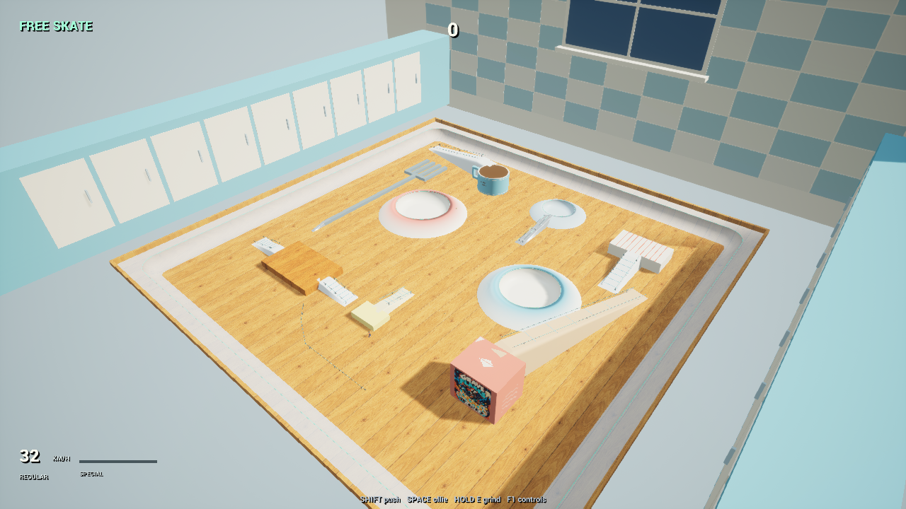

# Reusing the skating foundation for a giant kitchen and district tour

I wanted another level to change how routes are read, while keeping the same skating and survival rules. After Hours turns dishes, cutlery, a mug and a cereal carton into a giant kitchen skate space. It joins Borough, Hollow and Neon as the fourth playable district.

*Staged overview from the cooked Windows 0.99 build. The kitchen art is original; this image is presentation evidence, not an ordinary-run result.*

## Shared geometry, different routes

Three circular dishes provide curved vert surfaces and continuous coping grinds. Forks branch into rail lines, the mug handle provides a passage, and banks reach raised household surfaces. A round mug uses one circular footprint for physical contact, support, camera clearance and the map. Its rim is a connected grind route.

Original generated wood and carton artwork provide surface identity. The first presentation exposed coarse bank edges and a mirrored carton label. Dedicated bank meshes now agree with the ridden surface, and corrected texture coordinates present the artwork normally. These changes reuse the existing material and geometry systems instead of creating a second movement implementation for the theme.

## Encounters and destination decisions

The Head Chef commits to warned fork stamps and charges. Three parallel tines leave gaps to carve through; a moving combo bank can expose the recovery window. The encounter reuses the shared swept-hazard, pause, cleanup and reward logic. Its silhouette comes from the existing instanced character renderer.

The garage supports a one- through four-district run. After a non-final extraction, the route screen offers unvisited destinations and carries the earned build, health and progression forward. When one destination remains, travel continues directly. The Night Mayor appears at the actual final stop of the longer campaigns. Route previews come from the same geometry used in play.

## Delivery and the failure it exposed

Windows 0.99 packages these changes. The actual executable passes 45 kitchen, 779 survival, 17 keyboard/controller route-input and six earned-profile reload checks. All seven cooked kitchen art views were inspected. The reload uses an earlier legitimately earned profile; it does not establish a new campaign victory.

An ordinary-starter automated tour earned four weapons and two evolutions, defeated the Head Chef and reached Borough. It then became trapped near the stairs: the bench and manual pad left a 55 cm gap against a 70 cm rider collision volume. Opposing separation pushes repeatedly cancelled movement and gravity. Combat continued, but the tour did not.

The eight-minute sample is retained as a failure to complete, not a victory. The development correction opens the passage and resolves overlapping solids together, checking rail and tree clearance before accepting an exit at the same height. The standalone package above predates that correction. New automated runs also stop after ten seconds confined to a small area so a stalled policy cannot consume the rest of a long verification window.

The correction passes 28 focused contact checks and 779 survival checks. One subsequent ordinary development tour reaches all four districts, completes all four showdowns and reaches the Night Mayor's third phase without another stationary stall. The eight-minute verification cap ends before boss defeat, so final extraction and the saved result remain unaccepted. The earned Landing Quake build produces 165 moving touchdown waves and 1,062 finishing hits. Stage-two, stage-three, stage-four and final boss frames were inspected. This is progress through the corrected route, not a completed victory or a new packaged release.

## What this changes about the next pass

I now separate package delivery from campaign acceptance. A successful cook, passing mechanic checks and an earlier three-district victory did not prove the new four-district tour. The recorded obstruction provided a local reproduction before the next complete attempt. That attempt also showed that the old three-district verification duration was too short to finish the expanded tour; changing gameplay to force a win would conceal that measurement limit.

The game remains a playable alpha. Current tour reliability, broader build viability, consistent movement/camera quality and finished presentation still need acceptance. Mobile and music remain deferred. [The connected-campaign record](2026-10-29-01-connected-campaign.md) covers the larger survival and performance work leading into this delivery.
