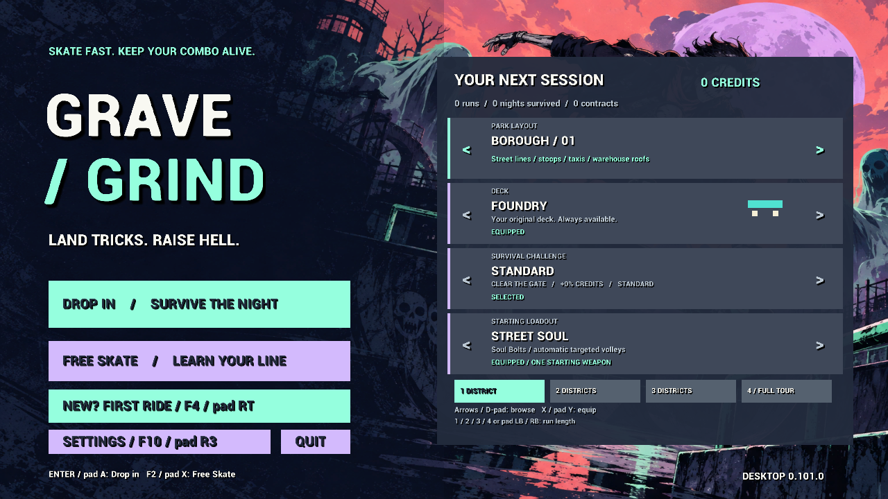
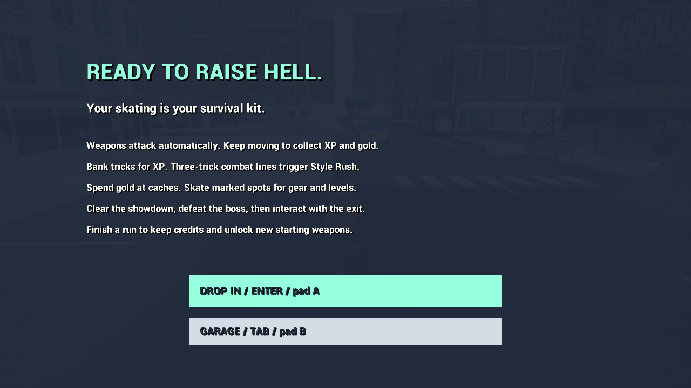

# Making the desktop game understandable and safe to leave

The complete campaign needed a better first session and a reliable path back out. I prioritized teaching the skating loop, protecting earned progress and making desktop preferences usable before adding another combat system. This milestone also brings the preceding district-horde presentation and four-district reward correction into the public record.

## Learn on the actual streets

First Ride introduces pushing, an airborne trick with a banked landing, a half-second grind and a manual-to-ollie line. Each lesson uses production movement and ordinary city geometry. The rail lesson highlights a real low rail; retries reset through the normal run lifecycle so stale air, rail or input state cannot leak into the next attempt.

Training runs without enemies or persistent rewards. Completion leads directly to survival, where a compact guide advances after actual banks, upgrade choices, cache purchases, completed spots and a defeated boss. The guide explains the existing loop without inserting equipment, changing difficulty or interrupting combat with new tutorial menus.

## Protect the session

Leaving an unfinished survival run now requires confirmation. Cancel preserves the run clock, momentum and combo. A failed reward write remains in memory and must be retried before the in-game exit path discards that state. Losing application focus pauses play and consumes held inputs; returning requires an explicit resume.

Display mode and resolution changes use a fifteen-second confirmation window. Timeout, cancellation or focus loss restores the prior display. Windowed resolution, render scale, camera roll and skating assistance join the existing performance, sound-effects and look options. Launchers preserve saved display choices. Camera-roll reduction changes presentation without changing steering or skating physics.

## Give the crowds a physical identity

Twelve district outfits and distance-driven footsteps replace a single generic crowd appearance. Hound, brute and gravebell attacks have poses tied to their attack clocks. The same pose model supports nearby and coarse distant rendering. No Fall mode also hides the balance meter whose risk only applies with classic bails.

## Repair the campaign-to-profile boundary

The earlier four-district campaign reached its ending but discarded rewards. Campaign selection allowed four districts while result validation still rejected counts above three. Sharing the supported district count fixes that mismatch without changing the save format or reward formula.

The preserved 0.100.1 ordinary automated run completes all four showdowns, defeats the Night Mayor and extracts after 623.33 game seconds, with 13,829 kills. Its zero-credit result remains evidence of the defect. Version 0.100.2 passes direct completed-result save checks and a fresh-process reload of a controlled four-district profile. That fixture is not presented as the naturally earned save from the failed campaign, and another full tour was not run merely to obtain a cleaner result.

## Delivery evidence

Windows 0.101.0 now builds in Shipping configuration and has a local portable ZIP with a player guide, runtime notices and prerequisites. The ZIP contains 27 selected files, passes its integrity check and contains the same executable as the tested archive. Local profiles, logs and test captures are excluded.

| Actual Shipping executable check | Result |
| --- | --- |
| Hybrid and session integration | 820 passed, 0 failed |
| Existing keyboard/controller menu flow | 38 passed, 0 failed; 13.90 seconds |
| First Ride, survival handoff, exit and display flow | 16 passed, 0 failed; 13.88 seconds |
| Fresh-process settings restoration | 5 passed, 0 failed |

The input replay completes all four real lessons. Preview timeout is checked by expiring its deadline; camera/render preferences use production setting methods. Final garage, rail lesson, survival handoff, guidance and settings frames were inspected. This is automated input and rendered review, not a hands-on playtest or another full-campaign victory.

*Selected Windows 0.101.0 automated-replay captures, 30 October 2026.*

## Problems and process changes

The first reward-save diagnosis blamed verification isolation. A second completed campaign still failed to save; tracing reward validation exposed the real three-district limit. The next investigation should follow the rejected result through calculation, recording and disk writing before spending time on another long campaign.

The new input replay initially emitted releases for keys it had never pressed. Unreal's held-key accounting then cancelled the intended push. Tracking actual key edges fixed the driver without weakening the skating criteria. Engine debug bindings also occupied gameplay function keys; clearing those bindings removed the conflict. Rendered review caught a guide overlapping an existing banner and a misleading zero-percent label for Unreal's default render scale.

The first Shipping compilation found an older replay helper depending on a profiler unavailable in that configuration. Optional profiler calls now follow the engine's compile-time availability flag. Editor success alone is insufficient evidence for a distributable build; the final executable needs its own short acceptance pass.

## Remaining acceptance

I am keeping this labeled a desktop candidate. These bounded automated checks and rendered reviews do not establish physical-controller feel, exact THPS equivalence, clean-machine compatibility or sustained current-version late-horde performance. Broader build viability and finished presentation remain open. Unfinished runs cannot resume after closing, and forced operating-system termination cannot preserve an in-memory failed save. Music and mobile remain deferred; no public playable download is released by this documentation milestone.
