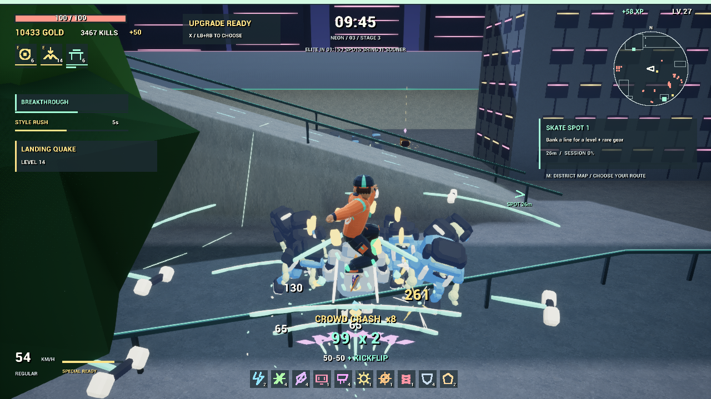

# Connecting skating routes to survival encounters

I wanted the survival loop to reward a useful skating line from approach through combat, collection and the next upgrade. The [previous combat rescue](2026-11-04-01-skating-as-combat.md) supplied attacks and feedback, but their existence did not establish a satisfying game. This milestone connects those mechanisms across encounters and records a completed campaign without treating completion as proof of enjoyment.

*Actual development-build capture from the earned four-district automated run. This is one recorded view, not hands-on or whole-run visual acceptance.*

## Encounters along the line

Street deployments now form readable groups with short recovery intervals. Refills finish a fixed group instead of scattering its remaining members as the rider turns. Validated ramp, rooftop, rail-exit and projected-landing approaches place combat along usable skating routes. Nearby damage, approach, attack commitments and a deadline release held formations into pursuit; showdowns and bosses retain continuous pressure.

Committed enemy charges and area attacks can hit the crowd. Moving through a warned attack therefore creates a useful consequence beyond avoiding damage. Pulse guidance uses the actual windup and damage window, correcting a shorter prediction horizon that could miss the approaching danger.

Drop-In and Rail Runner provide free landing- and grind-led starts. New profiles begin with Drop-In; existing selections are preserved. Reaper power remains stored between encounters and spends only against reachable targets. During boss recovery, an earned skating hit can open the existing damage window, including the initiating blow, while shields and phase limits remain authoritative.

## Carrying a line's payoff

The next development change addresses a concrete timing mismatch: a qualifying bank on an empty street previously earned no combat payoff, while an unreachable nearby enemy could still waste its blast. A bank now stores one capped combo blast when no valid target is available. An actual moving approach releases it into the next reachable pack; the swept path catches fast crossings without steering the board. Walls, other floors, spawning enemies and protected boss phases preserve the charge. Further banks strengthen one slot rather than stacking attacks.

An empty-street bank grants no permanent damage multiplier. Its first actual carried hit activates the bounded rush; a bank already credited in combat cannot claim another rush for the same release. The HUD identifies the loaded attack. This change is in the rebuilt development game and follows the 0.109.0 standalone boundary below.

## Rewards without constant stops

The completed campaign exposed 47 individual upgrade choices across 556 seconds of active play. I grouped up to three already affordable choices into one automatic stop from level five. Each choice still spends its own XP, explicit access remains available, and skipping leaves unopened XP intact. A subsequent short run made seven choices in five stops. That demonstrates grouping; it does not measure a human's decision time or a controlled percentage improvement.

Optional rare-or-better stashes now use existing elevated skating routes. Placement checks ramp grade, flat runup, clearance and supported arrival. Map guidance follows the entrance and crest; collection rejects the street underneath. These are exploration rewards within the existing campaign.

## Evidence and its limits

| Scope | Recorded result |
| --- | --- |
| Carried combo development | The rebuilt editor passes its mechanics suite, including 23 new integration cases. A 45-second ordinary automated opening earns six blasts: five carry into later packs, with 19 actual enemy hits. Two prepared and two ordinary views were inspected; no full-run or enjoyment claim follows. |
| Earned campaign before grouped upgrades | An ordinary automated 556.47-second tour completes Borough, Hollow, Neon and After Hours, evolves Orbit/Quake/Reaper, defeats the final boss and deliberately extracts. A separate process restores the earned profile without duplicate rewards. |
| Current standalone | Local Windows 0.109.0 includes boss counters, grouped upgrades and elevated routes. Its prepared keyboard integration route, earned-profile reload and portable archive checks pass. |
| Alternative build | A 45-second ordinary Shipping Saw Runner sample acquires lightning and records real contributions from both weapons, skating and gear. It is an opening, not another completed build. |
| Late performance | A separate earned run's final 30 seconds average 16.681 ms per frame at 1280×720 on Ryzen 5 1600 / GTX 1060, with 108–266 enemy slots and one 39 ms hitch. The separate 300+ ordinary-enemy gate remains unproven. |
| Elevated exploration | Seven prepared skating approaches purchase their rewards. An ordinary automated attempt reaches the approach but collects no elevated stash; ordinary acquisition remains unverified. |

These outcomes belong to their recorded builds. The earlier campaign and performance run are not relabeled as full acceptance of the latest Shipping executable.

## Problems and the next approach

Initial stash candidates included a bank too steep for ordinary pushing and a runup crossing another surface. Placement now requires the actual supported grade and a flat approach. A separate capture helper then trapped its own driver in the map; removing that verification-only hook corrected the helper without changing production input. The remaining failed ordinary acquisition is retained rather than hidden behind the passing prepared routes.

The recurring process risk is confusing extensive mechanical evidence with a good player experience. I am keeping the full survival scope while requiring each new intervention to address an observed connection in the playable loop. Short checks establish integration; another long campaign or a larger pass count cannot settle whether the hybrid is enjoyable.

The project remains a playable alpha. Enjoyment, broader completed-build comparisons, heavier ordinary crowd performance, hands-on controller acceptance, clean-machine compatibility and finished presentation remain open. The private workshop contains the implementation and detailed evidence; this public repository contains the curated record, not a public game release.
