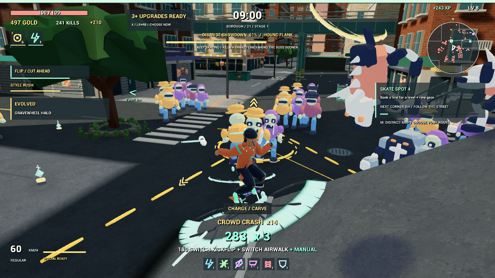

# Making skating builds survive the full campaign

My goal for this batch was to carry a deliberate skating build through a complete survival run. Useful attacks were already present, but acquisition, encounter placement and district transitions could undermine their value. Windows 0.116 brings the accumulated changes into one desktop candidate. Overall enjoyment remains an unresolved acceptance criterion.

*Ordinary scripted-input run in Windows 0.116, sixty seconds into Borough. This capture shows production rewards and combat; it is not hands-on play or a performance benchmark.*

## Keeping the chosen build coherent

The first equipment draft now includes a match for each of the six starters and two distinct alternatives. Choosing another style offers its weapon on the next earned draft. Acquiring a developed weapon's partner preserves the main upgrade focus; upgrading an owned secondary changes that focus deliberately. Rerolling a pairing offer retains the pair opportunity while changing its bonuses.

Three existing pairs add different payoffs: rail power becomes forward cuts on a landing, manual wheel bursts trigger lightning, and returning discs release a targeted bolt volley. Weapons can also earn their evolution through their own combat finishes when a skating-specific objective has stalled. These paths retain actual level costs and weapon slots.

Automatic upgrades group up to three earned choices after the opening style and leave a riding interval between windows. Immediate threats defer the pause. Finite street recovery gives a damaged run somewhere useful to go without adding another menu.

## Connecting attacks to the route

Forward weapons use actual travel rather than the rider's facing during a spin. The first moving airborne flip releases a forward cut. Evolved Faultline landings send delayed ground strikes ahead while preserving linked manuals and ollies; walls and unsupported edges stop them. Painted cuts and surface ribbons distinguish those attacks from contact flashes and hostile warnings.

Street guidance now finds supported routes around corners, respects explicit destination pins and favors the direction already being ridden. Hollow gains connected crypt streets and roof access. District lighting and scenery distinguish Borough, Hollow, Neon and the giant kitchen. These changes preserve the accepted movement foundation.

A later inspection exposed a separate encounter defect: showdowns, swarms and boss fights discarded their formation plan on every refill and omitted the approach hold. Persistent groups now complete their fixed slots during those phases. Close approaches, hits and the waiting deadline still release pursuit; committed attacks remain active. Pressure removes the quiet interval while retaining the physical skating approach.

District bosses also receive a guarded midpoint signature followed by a skating counter opportunity. The Night Mayor retains two transitions across three health segments. Actual damage accounting excludes protected phases.

## What the current candidate demonstrates

One ordinary scripted-input tour completes all four districts, the Night Mayor and deliberate extraction in 8 minutes 12 seconds. Its evolved Orbit with rank-one Thunder earns 64 lightning bursts with 89 damaging contacts. Four boss counter openings are used. Forty-seven earned choices occupy nineteen upgrade windows, and seven recovery packs restore about 108 health.

The result adds a genuine saved victory and credits. A fresh process restores the profile, preserves the equipped starter and begins another ordinary run without duplicating rewards. The current packaged mechanics checks and portable-archive integrity checks pass. Six ordinary frames were inspected.

Separate recent runs complete Quake/Reaper and Sawline/Bolts builds on their documented development revisions. Together they demonstrate different earned attack interactions; they are not three current-version campaign comparisons. The current tour samples a peak of 379 enemy slots, but adjacent samples above 300 cover only about six seconds. Sustained crowded frame times remain unverified.

## Problems, lessons and the next approach

An earlier Saw starter run developed mainly into Orbit. Its selection policy helped cause that outcome, so a victory alone was insufficient evidence that Saw's build path worked. The acquisition correction was followed by a deliberately selected, earned Sawline/Bolts completion. Future build comparisons need to record the actual developed weapons and their contribution.

The pressure-phase defect survived checks of ordinary street formations. Verification now follows a group across the transition into each pressure phase and through subsequent refills. A mechanic needs coverage where the campaign actually uses it.

I also need a stronger separation between functional completion and enjoyment. More systems, successful automated runs and larger check totals have not resolved the negative play experience. The next substantial decisions should address the experience of choosing and completing a satisfying skating line through combat. Hands-on feedback, exploration value, crowded readability, physical controller feel and clean-machine acceptance remain open. The proposed short demolition experiment remains a proposal; the full survival scope has not been replaced.

Development is AI-assisted. Automated input, prepared fixtures, rendered review and human evaluation remain explicitly distinguished. This is a local desktop candidate, not a public playable launch or a claim of exact reference-game parity.
