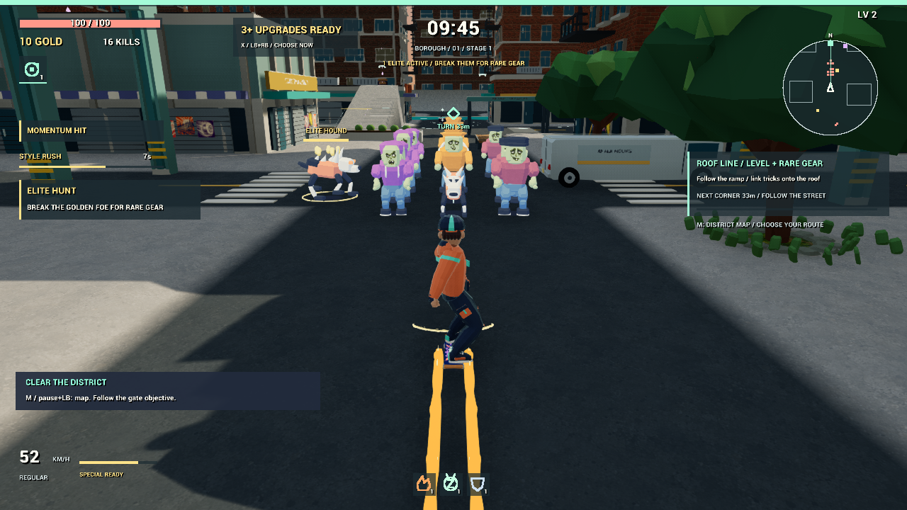

# Connecting city routes, crowds and rooftop rewards

I want skating through the city to lead into useful combat encounters. A good movement system loses value when enemies collect behind the board, a rooftop reward leaves no onward route, or the next crowd sits beside an unrelated rail. This milestone connects existing city surfaces, exploration rewards and enemy placement while preserving the skating foundation.

*Ordinary scripted-input capture from Windows 0.119. The image shows the current painted crowd and a route through the approaching group; it is not hands-on acceptance.*

## Routes through the city

The previous street search rejected obstructed routes whenever an endpoint stood above street terrain. Roof guidance now searches supported roof surfaces and joins them to streets through real banks. Every resulting segment retains body-clearance and surface-support checks. An inaccessible skyscraper cannot acquire an invented drop simply because a marker lies on the street below.

Borough's warehouse has a second bank on its southern side, making the roof a route through to another street. One planter moves to clear the approach. The first width check exposed contact with an adjacent manual pad; moving and narrowing the bank preserved that obstacle while clearing the new corridor.

Rooftop skate sessions also participate in the ordinary objective sequence. Their rewards require actual arrival on the supported roof. Named gear makes a premium detour understandable before committing to it, while the free session reward and onward gate route keep exploration connected to progression.

## Crowds along skating lines

Ordinary pursuit now uses a shared forecast of measured board travel. It chooses a reachable interception point without changing enemy speed or teleporting a foe into place. Dedicated rail groups follow real grind connections, including bends, and keep their visible members fixed through refills.

The same principle now applies to a followed city route. Six enemy rows use the local direction of supported corners, banks and roof exits. A grounded rider must be aligned with current guidance; stale or obstructed routes are rejected. Spawn distance, emergence, population budgets and collision rules still apply. Turning away discards only unfilled positions. Existing enemies retain their health and ordinary attack behavior.

An actual grind or grind input keeps priority. A merely nearby parallel rail no longer overrides a qualifying street route. This distinction makes encounter selection respond to stronger evidence of current intent.

One 60-second development opening spawned 80 members in connected-route groups. Of 59 defeated members, 57 received skating-finisher credit. These are group-membership totals, not a claim that every defeat occurred on a bend or bank. That sample reached and claimed its roof session but did not complete a showdown or boss fight.

## Crowd presentation

Original AI-generated face and fabric textures replace repeated geometric facial details. Four stable expressions, faceted heads and tapered coats retain the existing movement and district silhouettes. The face and clothing materials share the foreground cutaway, keeping the rider visible through nearby bodies. Their Shipping materials receive a fresh cook in Windows 0.119.

The texture and mesh checks establish rendering behavior. They do not establish a broad performance improvement or reference-game visual parity.

## Delivery and evidence

Windows 0.119 builds, cooks and archives successfully. Its mechanical checks pass 1,616 cases. Prepared routes cover all four districts, with separate checks for fixed refills, grind priority, stale guidance, facade rejection and once-only defeat credit.

One ordinary scripted-input Saw Runner campaign completes all four districts and the Night Mayor in 435 seconds. Its starter was legitimately unlocked by a previous earned victory. The actual build is evolved Sawline with Soul Bolts, producing 266 paired return volleys. Four showdowns, three district midpoints and both finale transitions complete. A fresh process restores the resulting two-win profile and credits without altering the save. The portable archive passes integrity and private-data-exclusion checks.

On a Ryzen 5 1600 and GTX 1060 6GB at 1280×720, recorded game-loop intervals average 16.73 ms, with a 16.79 ms 95th percentile. Nine larger intervals align with screenshot writes and remain included in the metrics. Population peaks at 320, but only 3.83 seconds reach 300 or more enemies; the run also finishes before the declared late-load window. Sustained crowded performance remains unproven. This recording measures game-loop cadence, not GPU time, displayed frames or input latency.

## Problems and lessons

An automated roof approach previously added a circling offset wider than the bank itself. Correcting that input policy allowed it to follow the already validated segment. A separate production failure remained: leaving an elevated objective could still lose street guidance. Keeping those failures separate prevented a replay correction from being presented as a movement fix.

The external frame-capture tool also lacked Windows tracing permission. I added opt-in wall-clock recording at the existing run callback so the packaged game can report actual game-loop intervals alongside population. This is distinct from GPU time, displayed frames and input latency; those limits remain explicit.

Future checks should connect the physical route, actual encounter placement, earned reward and next destination in one bounded sample. Passing component checks or accumulating kills cannot decide whether the resulting game is enjoyable. Overall enjoyment, physical-input acceptance and sustained dense-horde performance remain open criteria.

This continues the full survival game described in the [previous milestone](2026-11-04-03-skating-builds-and-campaign.md).
