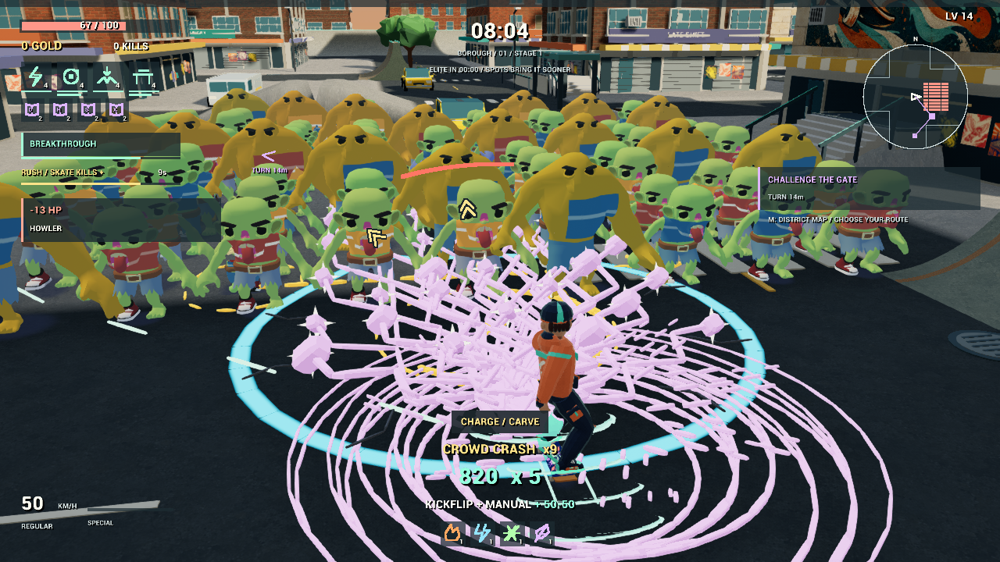
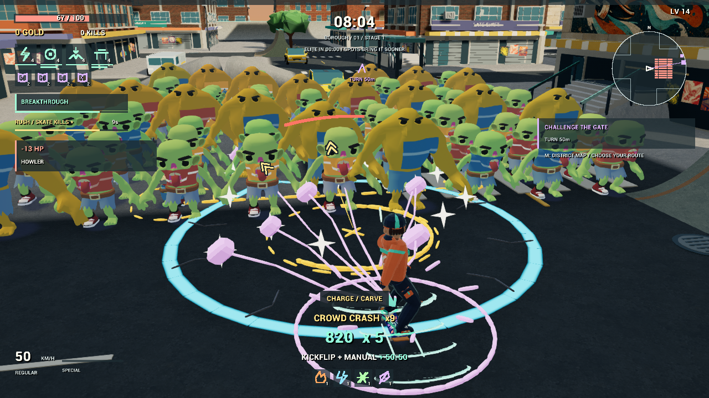

# Making skating attacks carry through the run

I kept the accepted skating foundation and focused this milestone on the survival interactions around it. Attacks could discharge into empty space, victory could leave reinforcement messaging active, and overlapping combat effects could hide the surface needed for the next landing. These were concrete interruptions to address before adding more systems.

## Carrying useful attacks

Completed manual lines now store one wheel volley until actual movement brings reachable enemies into the approaching lane. The volley respects surfaces and cover instead of firing radially into an empty street. Its paired lightning follows distinct living targets, avoiding a burst centered on an enemy that has already died.

Fast braking turns produce a broad powerslide sweep. Ordinary low ollies retain board attacks along their actual flight path, while moving skating finishes can sustain an already-earned Style Rush. Heavy enemies also received a contact correction: their bodies could hurt the rider outside the basic board attack's reach. The attack now has an approach margin consistent with ordinary walkers.

Basic Quake and Reaper attacks continue between tricks, with stronger skating actions retaining separate payoffs. The intention is to make a build useful while moving and more expressive when a line comes together. These changes do not establish that the combined game is enjoyable.

## Giving encounters and victories an ending

Quiet-street encounters retain defeat ownership after deployment closes. Actual clears attract nearby earned drops and create a recovery interval; simply passing or recycling enemies does not count as a clear. Showdowns, swarms and bosses keep their continuous-pressure rules.

Boss defeat now ends reinforcement scheduling, keeps surviving enemies dangerous, and leaves a persistent reward-and-extraction objective. The next district resumes pressure normally. Guidance prioritizes actionable interactions rather than displaying competing tutorial, route, purchase and upgrade instructions together.

Neon's market gained connected shop roofs, a walkway, access banks and additional grind segments. The same surfaces serve the rider, enemy access and route guidance. This extends an existing district rather than multiplying unfinished levels.

## Keeping the next landing visible

Crowd presentation now uses adapted animated characters from the [Quaternius Zombie Apocalypse Kit](https://quaternius.com/packs/zombieapocalypsekit.html), published under CC0. Source art and motion are credited separately from the project's combat logic, baked animation playback and district clothing treatment. Boss body forms, bank/roof camera recovery and forward foliage clearance were also revised.

An ordinary late-run image exposed repeated catch rings and chain flashes burying the pavement beneath the board. I separated secondary hit feedback from live attacks and danger warnings. Visible, recent feedback receives a shared budget, nearby duplicates merge, and dense beam traces become thinner. Projectiles, landing fronts and hostile warnings keep their own rendering.

| Earlier feedback | Bounded secondary feedback |
| --- | --- |
|  |  |

*Prepared comparison with the same crowd, camera and 108 fixed secondary effects. Generated route destinations differ between launches. These are rendering fixtures, not ordinary gameplay or proof of better feel.*

## Evidence and its limits

Windows 0.124 completed an ordinary scripted four-district Saw Runner tour, defeated the finale and extracted at 571.95 seconds. The earned build combined evolved Sawline with Soul Bolts. Skating attacks received 1,483 of 8,714 finishes. A fresh process restored the saved second victory and credits without changing the profile.

Windows 0.125 packages the subsequent contact and feedback corrections. Its Shipping build, 1,758 integration checks, earned-save reload, selected dense-combat captures and portable-archive checks passed. The full tour remains evidence from 0.124; it was not repeated for this bounded delivery.

The recorded tour averaged 16.84 ms between eligible game-loop callbacks, with a 16.95 ms 95th percentile. Peak population reached 349, but the longest late interval above 300 lasted only 5.69 seconds. That does **not** meet the declared 30-second sustained-load requirement. Capture overhead remains included; these figures are not GPU, display or input-latency measurements.

## Problems, lessons and the next approach

A first attempt to shrink slash artwork made ordinary aerial attacks too thin. The final change preserves the small-attack silhouette and constrains oversized artwork instead. The scripted rider's post-boss rail detours also required a driver correction; that fix was not presented as a player-facing movement improvement.

The broader lesson is that successful tours and growing feature counts are weak substitutes for enjoyment. My assessment of the hybrid remains negative. The next design decision needs a concrete improvement in the moment-to-moment loop, with brief verification that can change the decision. Repeating complete tours or adjusting encounter thresholds from aggregate kill counts would not answer that question.

The desktop game remains a development build. Physical-input acceptance, clean-machine compatibility, sustained heavy-load performance and overall enjoyment are still open. A public playable launch has not occurred.
