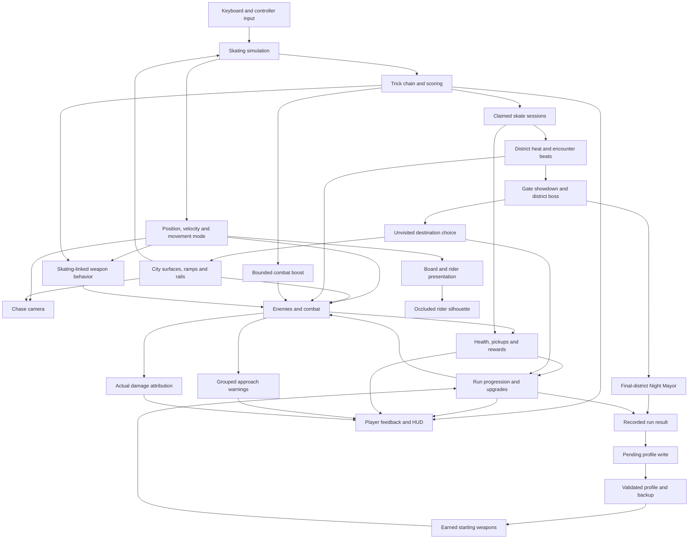

# System map

I use this map to explain how movement, presentation and survival systems share player and run state in the Unreal game module. It shows conceptual relationships rather than independent services or an exact call sequence.

## Movement and presentation

Skating advances at a fixed 120 Hz simulation step, with movement interpolation for presentation. The chase camera responds to movement and environment information. The central concern is continuity through landing, manual, ollie, rail catch and departure transitions.

Surface interaction and presentation must agree about board support. To preserve forgiving inputs, I retained generous lateral catch assistance while limiting forward snapping and protecting the intended rail choice. Intermediate camera-clearance checks account for obstacles along the path, even when the destination is clear.

## Survival connection

Combat and run progression share player position and run state. Banked lines advance linked skate sessions and grant a bounded combat boost near enemies. Moving grinds carry Reaper attacks into subsequent tricks, manuals prepare orbital bursts, meaningful landings release quake attacks and Afterburner follows ridden surfaces. Claimed spots provide experience and gear, increase district heat and advance recurring encounter beats with recovery intervals.

A deliberate gate interaction starts a three-wave showdown, then the district boss. Non-final extraction offers unvisited destinations; travel retains earned equipment and progression. The Night Mayor occupies the actual final district of longer campaigns. Departure settles bank-induced deaths and eligible loose rewards before recording the result.

## District geometry and combat clarity

District geometry also determines weapon visibility, surface-aware hazards and enemy roof approaches. The transit crossing separates its physical underside from its supported top. Navigation reaches its bank crest before aligning on the station roof, avoiding an early turn off the approach. Camera focus can remain beneath the slab while swept obstruction still prevents passing through it.

The kitchen uses the same surface, support and hazard systems for circular dishes, a round mug, banked carton access and cutlery grinds. Boss variants reuse committed hazards and combo-bank recovery while changing their attack geometry and presentation.

Approach warnings reuse committed attack geometry and keep a bounded set of directions. Actual mitigated health loss feeds the damage ledger independently of those predictions. The rider and board contribute a depth/stencil silhouette when occluded; foreground enemy clearance additionally exposes the board and escape line. Indexed city queries, local enemy-neighbour queries, cached distant routes and retained render-instance buffers limit repeated crowd work.

## Persistence and desktop flow

Run accounting rejects duplicate results independently of disk writing. A pending-write state allows garage/start/equip flows to retry a failed save without granting the result again. Validated profile replacement and backups preserve the prior valid state. Earned totals unlock starting weapons; unavailable saved selections fall back safely.

Menu confirmation ownership prevents controller presses from becoming skating actions on transition. Desktop settings persist display, sound-effects and look preferences separately from the progression profile.

## Verification boundary

Automated checks cover specific movement rules, combat interactions, input transitions and persistence boundaries. Rendered captures provide evidence for board support and visibility. Bounded ordinary-run captures include real reward acquisition and losses; they are distinguished from staged fixtures. Measured crowd samples do not establish longer survival or final release performance, and hands-on feel remains a separate question.

The diagram uses [GitHub’s supported Mermaid format](https://docs.github.com/en/get-started/writing-on-github/working-with-advanced-formatting/creating-diagrams).
