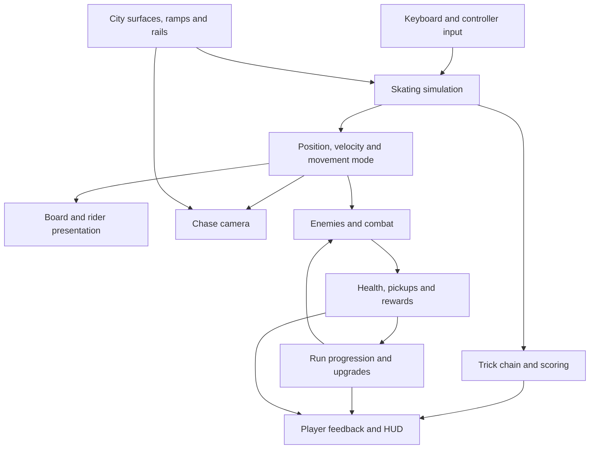

# My system map

I use this map to explain how movement, presentation and survival systems share player and run state in my Unreal game module. I’m showing conceptual relationships, rather than independent services or an exact call sequence.

## My movement and presentation model

I advance skating at a fixed 120 Hz simulation step, interpolate movement for presentation and drive the chase camera from movement and environment information. I focus on continuity through landing, manual, ollie, rail catch and departure transitions.

I make surface interaction and presentation agree about board support. I preserve generous lateral catch assistance while limiting forward snapping and protecting the intended rail choice. I also check intermediate camera clearance because a clear endpoint can still require moving through an obstacle.

## My survival connection

I connect combat and run progression to player position and run state, with enemy updates, pickups and upgrade choices already present in the prototype. I use free skate to isolate movement problems, while treating the full loop under enemy pressure as a separate integration concern.

## My verification boundary

I use automated checks for specific movement rules and input sequences, then review rendered captures for board support and visibility. I still need separate evidence for hands-on feel, crowded-survival performance and the overall player experience.

I keep this diagram in [GitHub’s supported Mermaid format](https://docs.github.com/en/get-started/writing-on-github/working-with-advanced-formatting/creating-diagrams).
