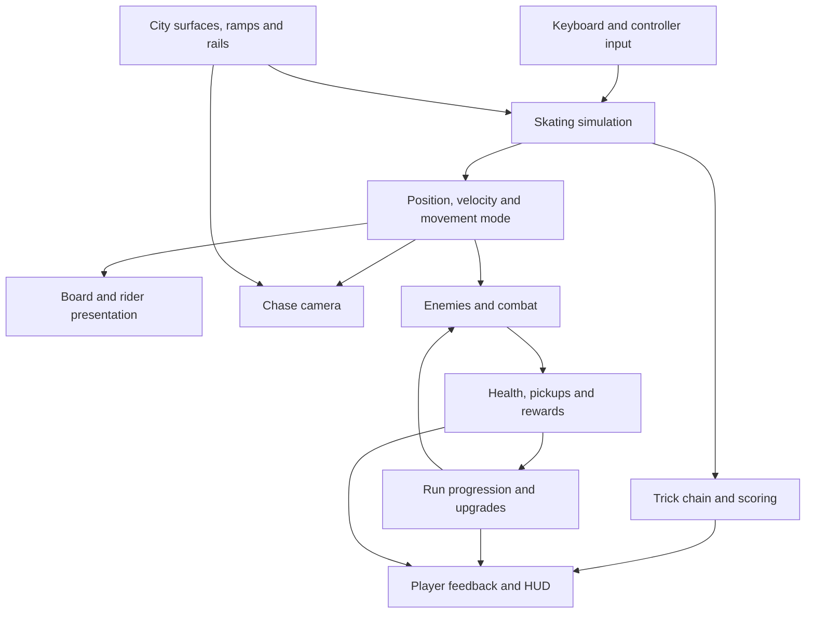

# System map

This is a conceptual view of the current prototype, not a diagram of independent services or an exact call sequence. The systems share player and run state inside the Unreal game module.

## Movement and presentation

Skating advances at a fixed 120 Hz simulation step. Render interpolation feeds rider presentation, and the chase camera uses movement and environment information. The recent work focused on continuity across state transitions: landing, manual, ollie, rail catch and rail departure.

Surface interaction and presentation must agree about support. A generous input assist can help acquire a rail, but it should not look like a long teleport or let a nearby unintended rail steal the line. Camera candidates also need a clear path between positions, not merely a clear endpoint.

## Survival connection

Combat and run progression use the player's location and run state. The prototype includes enemy updates, pickups and upgrade choices. Free skate allows focused movement work; it does not establish how the complete loop performs under enemy pressure.

## Verification boundary

Automated movement checks cover specific rules and input sequences. Rendered captures help assess board support and visibility. Hands-on feel, crowded-survival performance and the overall player experience need separate evidence.

The diagram uses [GitHub's supported Mermaid format](https://docs.github.com/en/get-started/writing-on-github/working-with-advanced-formatting/creating-diagrams).
