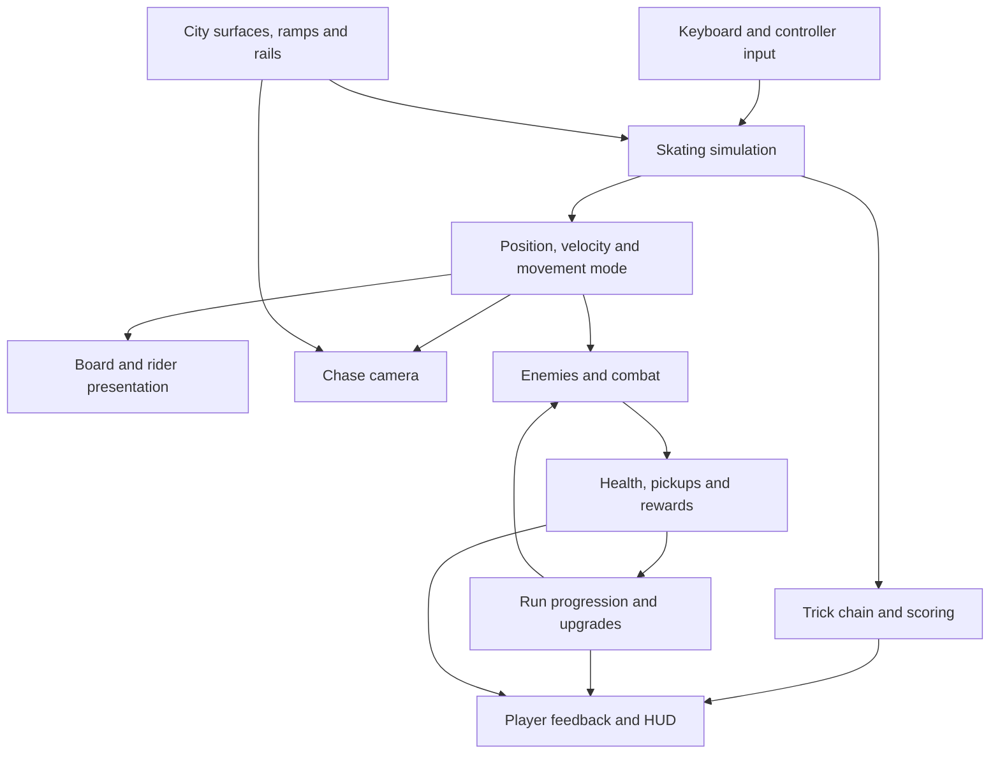

# System map

I use this map to explain how movement, presentation and survival systems share player and run state in the Unreal game module. It shows conceptual relationships rather than independent services or an exact call sequence.

## Movement and presentation

Skating advances at a fixed 120 Hz simulation step, with movement interpolation for presentation. The chase camera responds to movement and environment information. The central concern is continuity through landing, manual, ollie, rail catch and departure transitions.

Surface interaction and presentation must agree about board support. To preserve forgiving inputs, I retained generous lateral catch assistance while limiting forward snapping and protecting the intended rail choice. Intermediate camera-clearance checks account for obstacles along the path, even when the destination is clear.

## Survival connection

Combat and run progression share player position and run state, with enemy updates, pickups and upgrade choices already present in the prototype. Free skate isolates movement problems; the full loop under enemy pressure remains a separate integration concern.

## Verification boundary

Automated checks cover specific movement rules and input sequences. Rendered captures provide evidence for board support and visibility. Hands-on feel, crowded-survival performance and the overall player experience require separate evidence.

The diagram uses [GitHub’s supported Mermaid format](https://docs.github.com/en/get-started/writing-on-github/working-with-advanced-formatting/creating-diagrams).
